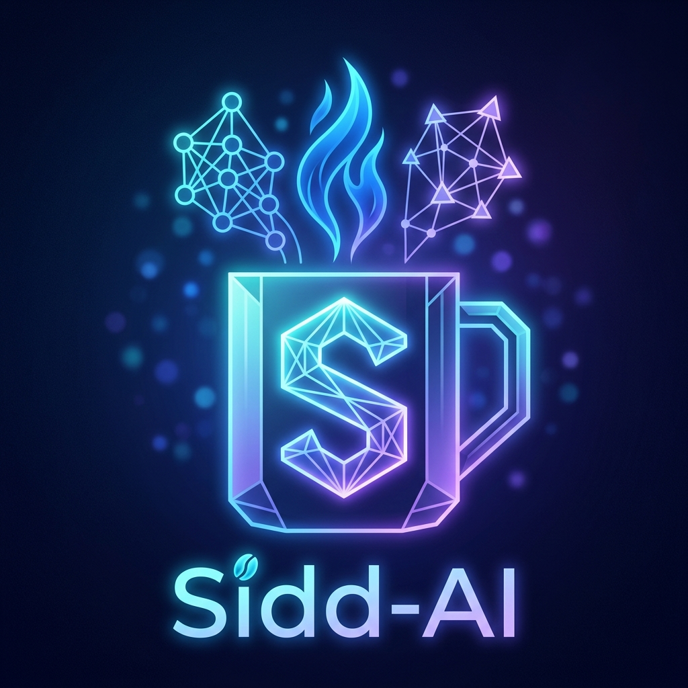

<div align="center">



# sidd-ai

**One lightweight Java SDK for every major LLM provider.**

Call OpenAI, Google Gemini, Anthropic Claude, xAI Grok, Groq, NVIDIA NIM, Moonshot Kimi, and local Ollama models through a single, framework-agnostic API.

[](https://central.sonatype.com/artifact/io.github.prabhusiddarth/sidd-ai)
[](https://github.com/PRABHUSIDDARTH/sidd-ai/releases)
[](https://openjdk.org/)
[](LICENSE)

[Installation](#installation) •
[Quick Start](#quick-start) •
[Providers](#supported-providers) •
[Configuration](#configuration) •
[API Reference](API_REFERENCE.md) •
[Contributing](#contributing)

</div>

---

## Overview

`sidd-ai` is a minimal Java library that gives you a single, consistent interface to multiple AI providers. It requires no Spring context, no dependency injection, and no YAML configuration. It works in a plain `main()` method, a CLI tool, a desktop app, or any server framework.

```java
String answer = AiClient.chatQuick("gpt-4o", "Explain recursion in one sentence.");
```

If you know LiteLLM from Python, `sidd-ai` aims to fill the same role for Java.

### Key Features

- **Unified API**: one `AiClient` for eight providers, so switching models means changing a string.
- **Automatic model routing**: `ModelRouter` picks the provider from the model name prefix.
- **Explicit provider selection**: `chatWithProvider(...)` bypasses prefix routing when you need it.
- **Zero-config credentials**: API keys load from environment variables or a local `.env` file.
- **Typed exceptions**: one hierarchy for auth failures, rate limits, and general API errors.
- **Response metadata**: `ChatResponse` exposes the content, the model, and token usage.
- **Minimal footprint**: built on the JDK `java.net.http.HttpClient`, with Jackson as the only runtime dependency.
- **Flexible distribution**: available on Maven Central, GitHub Packages, or as a self-contained fat jar.

### How It Compares

| Capability                    | Spring AI | LangChain4j | **sidd-ai** |
| ----------------------------- | :-------: | :---------: | :---------: |
| No framework required         |    No     |   Partial   |   **Yes**   |
| Works in a plain `main()`     |    No     |   Partial   |   **Yes**   |
| One-line static calls         |    No     |     No      |   **Yes**   |
| Unified exception hierarchy   |  Partial  |   Partial   |   **Yes**   |
| Model swap via string         |    Yes    |     Yes     |   **Yes**   |

---

## What's New in 1.0.5

- **Groq support**: new `GroqChat` provider (`GROQ_API_KEY`), routed for `llama-*` and `groq/*` models, with `groqApiKey(...)` on the builder and `"groq"` as an explicit provider key.
- **Expanded NVIDIA NIM routing**: adds the `openai/`, `meta/`, `mistralai/`, `microsoft/`, `ibm/`, `qwen/`, `deepseek-ai/`, `z-ai/`, `zhipuai/`, and `minimaxai/` namespaces.
- **Provider aliases**: `"claude"`, `"nvidia"`, and `"moonshot"` are accepted alongside `"anthropic"`, `"nim"`, and `"kimi"`.
- **Opt-in live smoke tests**: real calls against every configured provider, enabled with `-Dsidd.ai.liveTests=true`.

See the [releases page](https://github.com/PRABHUSIDDARTH/sidd-ai/releases) for the full changelog.

---

## Installation

**Requirements:** Java 17 or later.

### Maven

```xml
<dependency>
    <groupId>io.github.prabhusiddarth</groupId>
    <artifactId>sidd-ai</artifactId>
    <version>1.0.5</version>
</dependency>
```

### Gradle

```groovy
implementation 'io.github.prabhusiddarth:sidd-ai:1.0.5'
```

```kotlin
implementation("io.github.prabhusiddarth:sidd-ai:1.0.5")
```

### Standalone jar (no build tool)

A fat jar with all dependencies bundled is published under the `all` classifier.

```bash
curl -L -o sidd-ai.jar \
  https://repo1.maven.org/maven2/io/github/prabhusiddarth/sidd-ai/1.0.5/sidd-ai-1.0.5-all.jar

javac -cp sidd-ai.jar Main.java
java  -cp .:sidd-ai.jar Main      # use ; instead of : on Windows
```

---

## Quick Start

### 1. Static one-line call

Credentials are resolved automatically from environment variables or `.env`.

```java
import io.github.prabhusiddarth.sidd_ai.AiClient;

public class QuickStart {
    public static void main(String[] args) {
        String response = AiClient.chatQuick("gemini-2.5-flash", "Solve: 23 * 45");
        System.out.println(response);
    }
}
```

### 2. Configured client

Use the builder when you want to inject keys programmatically or set a default model. Any key you leave out falls back to its environment variable.

```java
import io.github.prabhusiddarth.sidd_ai.AiClient;
import io.github.prabhusiddarth.sidd_ai.ChatResponse;

AiClient client = AiClient.builder()
        .openAiApiKey("sk-...")
        .geminiApiKey("AIza...")
        .anthropicApiKey("sk-ant-...")
        .grokApiKey("xai-...")
        .groqApiKey("gsk_...")
        .nimApiKey("nvapi-...")
        .kimiApiKey("sk-...")
        .ollamaHost("http://localhost:11434")
        .defaultModel("gemini-2.5-flash")
        .build();

// Uses the default model
String answer = client.chat("Explain photosynthesis in one sentence.");

// Specific model, full response metadata
ChatResponse res = client.chatResponse("grok-4.3", "Hello, Grok!");
System.out.println(res.getContent());
System.out.println("Model:  " + res.getModel());
System.out.println("Tokens: " + res.getTokensUsed());
```

### 3. Switch providers by changing the model

```java
AiClient.chatQuick("gpt-4o", prompt);                     // OpenAI
AiClient.chatQuick("gemini-2.5-flash", prompt);           // Google Gemini
AiClient.chatQuick("claude-haiku-4-5-20251001", prompt);  // Anthropic Claude
AiClient.chatQuick("grok-4.3", prompt);                   // xAI Grok
AiClient.chatQuick("llama-3.3-70b-versatile", prompt);    // Groq
AiClient.chatQuick("openai/gpt-oss-20b", prompt);         // NVIDIA NIM
AiClient.chatQuick("kimi-k2.5", prompt);                  // Moonshot Kimi
AiClient.chatQuick("llama3.2", prompt);                   // Local Ollama
```

### 4. Explicit provider selection

If a model name has no recognizable prefix, or the same model is hosted by more than one provider, name the provider directly:

```java
String text = client.chatWithProvider("nim", "meta/llama-3.1-8b-instruct", prompt);
ChatResponse res = client.chatResponseWithProvider("groq", "openai/gpt-oss-20b", prompt);
```

Accepted provider keys: `openai`, `gemini`, `anthropic` / `claude`, `grok`, `groq`, `nim` / `nvidia`, `kimi` / `moonshot`, `ollama`.

### 5. Error handling

```java
import io.github.prabhusiddarth.sidd_ai.exceptions.*;

try {
    String answer = AiClient.chatQuick("claude-haiku-4-5-20251001", "Write a haiku about code");
} catch (AiAuthException e) {
    // Missing or invalid API key (HTTP 401)
} catch (AiRateLimitException e) {
    // Provider rate limit hit (HTTP 429): back off and retry
} catch (AiApiException e) {
    // Any other provider or transport error
}
```

All exceptions extend `AiException`, so you can also catch that single base type.

---

## Supported Providers

| Provider         | Routed model prefixes                                                                                                          | Example                     | Credential          |
| ---------------- | ------------------------------------------------------------------------------------------------------------------------------ | --------------------------- | ------------------- |
| OpenAI           | `gpt-`, `o1-`, `o3-`                                                                                                           | `gpt-4o`                    | `OPENAI_API_KEY`    |
| Google Gemini    | `gemini-`                                                                                                                      | `gemini-2.5-flash`          | `GEMINI_API_KEY`    |
| Anthropic Claude | `claude-`                                                                                                                      | `claude-haiku-4-5-20251001` | `ANTHROPIC_API_KEY` |
| xAI Grok         | `grok-`                                                                                                                        | `grok-4.3`                  | `GROK_API_KEY`      |
| Groq             | `llama-`, `groq/`                                                                                                              | `llama-3.3-70b-versatile`   | `GROQ_API_KEY`      |
| Moonshot Kimi    | `kimi-`, `moonshot-`, `moonshotai/`                                                                                            | `kimi-k2.5`                 | `KIMI_API_KEY`      |
| NVIDIA NIM       | `nvidia/`, `nim-`, `openai/`, `meta/`, `mistralai/`, `microsoft/`, `ibm/`, `qwen/`, `deepseek-ai/`, `z-ai/`, `zhipuai/`, `minimaxai/` | `openai/gpt-oss-20b`        | `NIM_API_KEY`       |
| Ollama (local)   | Any model that matches none of the above                                                                                       | `llama3.2`                  | `OLLAMA_HOST`       |

Prefix matching is case-insensitive and evaluated top to bottom. Note that `moonshotai/` models route to Kimi rather than NIM; use `chatWithProvider("nim", ...)` to force NIM.

---

## Configuration

Each provider reads its credential in this order:

1. The value passed to the `AiClient.builder()`
2. A system environment variable
3. A `.env` file in the working directory

Copy the template and fill in only the providers you use:

```bash
cp .env.example .env
```

```dotenv
OPENAI_API_KEY=...
GEMINI_API_KEY=...
ANTHROPIC_API_KEY=...
GROK_API_KEY=...
GROQ_API_KEY=...
NIM_API_KEY=...
KIMI_API_KEY=...
OLLAMA_HOST=http://localhost:11434
```

> **Security:** never commit your `.env` file. It is already listed in `.gitignore`. See [SECURITY.md](SECURITY.md) for how to report vulnerabilities.

---

## Architecture

```
AiClient ──► ModelRouter ──► Chat (interface)
                               ├── OpenAiChat
                               ├── GeminiChat
                               ├── AnthropicChat
                               ├── GrokChat
                               ├── GroqChat
                               ├── NimChat
                               ├── KimiChat
                               └── OllamaChat
```

Every provider implements the same `Chat` interface and returns a `ChatResponse`. HTTP failures are translated into the shared exception hierarchy. See [ARCHITECTURE.md](ARCHITECTURE.md) for the design and [LEARNING_GUIDE.md](LEARNING_GUIDE.md) for a guided walkthrough of the codebase.

---

## Documentation

| Document                                   | Description                                    |
| ------------------------------------------ | ---------------------------------------------- |
| [API_REFERENCE.md](API_REFERENCE.md)       | Every public class, method, and exception      |
| [ARCHITECTURE.md](ARCHITECTURE.md)         | Internal design and provider abstraction       |
| [LEARNING_GUIDE.md](LEARNING_GUIDE.md)     | Step-by-step guide to how the SDK is built     |
| [CONTRIBUTING.md](CONTRIBUTING.md)         | Contribution workflow and guidelines           |

---

## Building and Testing

```bash
git clone https://github.com/PRABHUSIDDARTH/sidd-ai.git
cd sidd-ai
mvn clean install
```

This runs the unit tests for every provider and the router, then installs the library and the `-all` fat jar into your local `~/.m2` repository.

To run the **live smoke tests**, which make real API calls against each provider that has a key configured:

```bash
mvn test -Dtest=ProviderLiveSmokeTest -Dsidd.ai.liveTests=true
```

Providers without a configured key are skipped automatically.

---

## Contributing

Contributions are welcome, especially new provider integrations. A provider is a single class, so adding one takes four steps:

1. Implement the `Chat` interface (use `OpenAiChat` as a reference).
2. Register its model prefixes in `ModelRouter` and `AiClient`.
3. Add a builder key and an explicit provider key in `AiClient`.
4. Add unit tests and open a pull request.

Please read [CONTRIBUTING.md](CONTRIBUTING.md) and the [Code of Conduct](CODE_OF_CONDUCT.md) before submitting.

---

## License

Distributed under the [Apache License 2.0](LICENSE).

<div align="center">

---

Built by [Prabhu Siddarth](https://github.com/PRABHUSIDDARTH). If `sidd-ai` is useful to you, consider giving it a ⭐ on GitHub.

</div>
